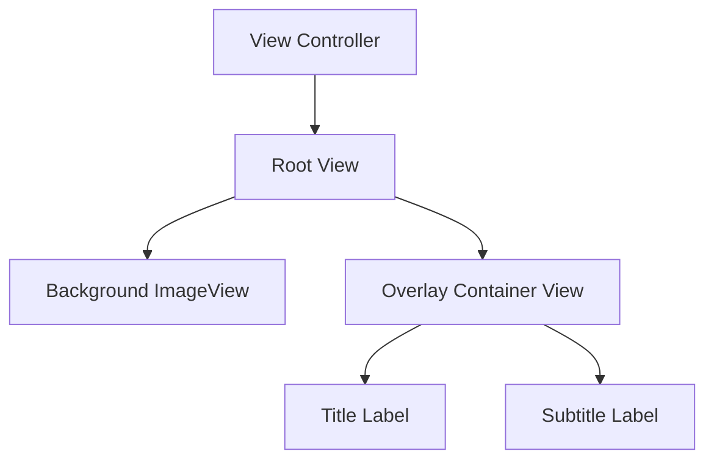

# App3 - UI Components Guide

## Table of Contents
- [Component Overview](#component-overview)
- [Storyboard Architecture](#storyboard-architecture)
- [UI Component Reference](#ui-component-reference)
- [Layout System](#layout-system)
- [Customization Guide](#customization-guide)
- [Best Practices](#best-practices)

## Component Overview

App3 uses a storyboard-based architecture with UIKit components to create a simple but elegant image viewing interface. The app demonstrates fundamental iOS UI patterns including full-screen imagery, overlay text, and responsive layout design.

### Component Hierarchy

```
Main Scene (ViewController)
└── Root View (UIView)
    ├── Background Image View (UIImageView)
    └── Overlay Container (UIView)
        ├── Title Label (UILabel)
        └── Subtitle Label (UILabel)
```

## Storyboard Architecture

### Main.storyboard Structure

The main storyboard defines the primary user interface using Interface Builder components:

**Scene Configuration:**
- **Initial View Controller:** `BYZ-38-t0r`
- **Target Device:** iPad 11.0" (configurable for universal)
- **Orientation:** Adaptive (supports all orientations)
- **Safe Areas:** Enabled
- **Auto Layout:** Enabled

### Component Relationships



## UI Component Reference

### 1. Root View Controller

**Type:** `ViewController` (Custom Class)  
**Base Class:** `UIViewController`  
**Scene ID:** `tne-QT-ifu`

```swift
class ViewController: UIViewController {
    // Managed by storyboard
    // No explicit IBOutlets in current implementation
}
```

**Properties:**
- Background Color: White
- Auto Layout: Enabled
- Safe Area Guides: Enabled

### 2. Background Image View

**Element ID:** `KI2-pR-Hrs`  
**Type:** `UIImageView`

#### Configuration
```swift
// Programmatic equivalent
let backgroundImageView = UIImageView()
backgroundImageView.image = UIImage(named: "Howling King")
backgroundImageView.contentMode = .scaleAspectFill
backgroundImageView.isUserInteractionEnabled = false
```

#### Properties
- **Image Asset:** "Howling King" (1920x1080)
- **Content Mode:** Scale Aspect Fill
- **User Interaction:** Disabled
- **Horizontal Priority:** 251
- **Vertical Priority:** 251

#### Constraints
```swift
// Auto Layout Constraints
backgroundImageView.translatesAutoresizingMaskIntoConstraints = false
NSLayoutConstraint.activate([
    backgroundImageView.topAnchor.constraint(equalTo: view.topAnchor),
    backgroundImageView.leadingAnchor.constraint(equalTo: view.leadingAnchor),
    backgroundImageView.trailingAnchor.constraint(equalTo: view.trailingAnchor),
    backgroundImageView.bottomAnchor.constraint(equalTo: view.bottomAnchor)
])
```

### 3. Overlay Container View

**Element ID:** `Ove-Zh-kcg`  
**Type:** `UIView`

#### Configuration
```swift
// Programmatic equivalent
let overlayView = UIView()
overlayView.backgroundColor = UIColor.black.withAlphaComponent(0.52)
```

#### Properties
- **Background Color:** Black with 52.4% opacity
- **Height Ratio:** 30% of parent view height
- **Position:** Bottom-aligned

#### Constraints
```swift
// Auto Layout Constraints
overlayView.translatesAutoresizingMaskIntoConstraints = false
NSLayoutConstraint.activate([
    overlayView.leadingAnchor.constraint(equalTo: view.leadingAnchor),
    overlayView.trailingAnchor.constraint(equalTo: view.trailingAnchor),
    overlayView.bottomAnchor.constraint(equalTo: view.bottomAnchor),
    overlayView.heightAnchor.constraint(equalTo: view.heightAnchor, multiplier: 0.3)
])
```

### 4. Title Label

**Element ID:** `cbx-mT-EBF`  
**Type:** `UILabel`

#### Configuration
```swift
// Programmatic equivalent
let titleLabel = UILabel()
titleLabel.text = "King Is Howling"
titleLabel.textAlignment = .natural
titleLabel.lineBreakMode = .byTruncatingTail
titleLabel.font = UIFont.systemFont(ofSize: 20, weight: .medium)
titleLabel.textColor = .white
titleLabel.adjustsFontSizeToFit = false
```

#### Properties
- **Text:** "King Is Howling"
- **Font:** System Medium, 20pt
- **Color:** White (RGB: 1.0, 1.0, 1.0, 1.0)
- **Alignment:** Natural (leading-aligned)
- **Line Break Mode:** Tail truncation
- **Adjusts Font Size:** No

#### Constraints
```swift
// Auto Layout Constraints within overlay container
titleLabel.translatesAutoresizingMaskIntoConstraints = false
NSLayoutConstraint.activate([
    titleLabel.topAnchor.constraint(equalTo: overlayView.topAnchor),
    titleLabel.leadingAnchor.constraint(equalTo: overlayView.leadingAnchor),
    titleLabel.trailingAnchor.constraint(equalTo: overlayView.trailingAnchor)
])
```

### 5. Subtitle Label

**Element ID:** `abM-C5-n7Y`  
**Type:** `UILabel`

#### Configuration
```swift
// Programmatic equivalent
let subtitleLabel = UILabel()
subtitleLabel.text = "Never Messup"
subtitleLabel.textAlignment = .natural
subtitleLabel.lineBreakMode = .byTruncatingTail
subtitleLabel.font = UIFont.systemFont(ofSize: 17, weight: .semibold)
subtitleLabel.textColor = .white
subtitleLabel.adjustsFontSizeToFit = false
```

#### Properties
- **Text:** "Never Messup"
- **Font:** System Semibold, 17pt
- **Color:** White (RGB: 1.0, 1.0, 1.0, 1.0)
- **Alignment:** Natural (leading-aligned)
- **Line Break Mode:** Tail truncation
- **Adjusts Font Size:** No

#### Constraints
```swift
// Auto Layout Constraints within overlay container
subtitleLabel.translatesAutoresizingMaskIntoConstraints = false
NSLayoutConstraint.activate([
    subtitleLabel.topAnchor.constraint(equalTo: titleLabel.bottomAnchor, constant: 44),
    subtitleLabel.leadingAnchor.constraint(equalTo: overlayView.leadingAnchor),
    subtitleLabel.trailingAnchor.constraint(equalTo: overlayView.trailingAnchor)
])
```

## Layout System

### Auto Layout Implementation

The app uses Auto Layout for responsive design across different device sizes and orientations.

#### Constraint Priority System
1. **Required Constraints (1000):** Position and size relationships
2. **High Priority (750):** Content hugging and compression resistance
3. **Default Priority (250):** Baseline constraints

#### Responsive Behavior

**Portrait Orientation:**
- Overlay height: 30% of screen height
- Full-width image display
- Labels maintain leading/trailing margins

**Landscape Orientation:**
- Same proportional overlay height
- Image scales to fill available space
- Text remains readable with consistent spacing

### Safe Area Handling

The layout respects iOS Safe Area guides:

```swift
// Safe Area integration (handled by storyboard)
view.safeAreaLayoutGuide // Used for constraint relationships
```

## Customization Guide

### Programmatic Component Access

To modify components programmatically, add IBOutlets:

```swift
class ViewController: UIViewController {
    @IBOutlet weak var backgroundImageView: UIImageView!
    @IBOutlet weak var overlayView: UIView!
    @IBOutlet weak var titleLabel: UILabel!
    @IBOutlet weak var subtitleLabel: UILabel!
    
    override func viewDidLoad() {
        super.viewDidLoad()
        customizeComponents()
    }
    
    private func customizeComponents() {
        setupImageView()
        setupOverlay()
        setupLabels()
    }
}
```

### Image Customization

```swift
extension ViewController {
    private func setupImageView() {
        // Change image
        backgroundImageView.image = UIImage(named: "custom-background")
        
        // Modify content mode
        backgroundImageView.contentMode = .scaleAspectFit
        
        // Add image effects
        backgroundImageView.alpha = 0.8
        
        // Add corner radius (if needed)
        backgroundImageView.layer.cornerRadius = 12
        backgroundImageView.clipsToBounds = true
    }
}
```

### Overlay Customization

```swift
extension ViewController {
    private func setupOverlay() {
        // Change background color
        overlayView.backgroundColor = UIColor.systemBlue.withAlphaComponent(0.7)
        
        // Add gradient background
        let gradientLayer = CAGradientLayer()
        gradientLayer.colors = [
            UIColor.clear.cgColor,
            UIColor.black.withAlphaComponent(0.8).cgColor
        ]
        gradientLayer.frame = overlayView.bounds
        overlayView.layer.insertSublayer(gradientLayer, at: 0)
        
        // Add blur effect
        let blurEffect = UIBlurEffect(style: .dark)
        let blurView = UIVisualEffectView(effect: blurEffect)
        blurView.frame = overlayView.bounds
        blurView.autoresizingMask = [.flexibleWidth, .flexibleHeight]
        overlayView.insertSubview(blurView, at: 0)
    }
}
```

### Text Customization

```swift
extension ViewController {
    private func setupLabels() {
        // Custom fonts
        titleLabel.font = UIFont(name: "Helvetica-Bold", size: 24)
        subtitleLabel.font = UIFont(name: "Helvetica-Light", size: 18)
        
        // Custom colors
        titleLabel.textColor = UIColor.systemYellow
        subtitleLabel.textColor = UIColor.systemBlue
        
        // Text effects
        titleLabel.layer.shadowColor = UIColor.black.cgColor
        titleLabel.layer.shadowOffset = CGSize(width: 2, height: 2)
        titleLabel.layer.shadowOpacity = 0.5
        titleLabel.layer.shadowRadius = 3
        
        // Attributed text
        let attributedTitle = NSAttributedString(
            string: titleLabel.text ?? "",
            attributes: [
                .foregroundColor: UIColor.white,
                .strokeColor: UIColor.black,
                .strokeWidth: -2.0
            ]
        )
        titleLabel.attributedText = attributedTitle
    }
}
```

### Animation Examples

```swift
extension ViewController {
    func animateContentEntry() {
        // Start with overlay off-screen
        overlayView.transform = CGAffineTransform(translationX: 0, y: overlayView.frame.height)
        
        // Animate in
        UIView.animate(withDuration: 0.8, delay: 0.2, usingSpringWithDamping: 0.8, initialSpringVelocity: 0, options: .curveEaseOut) {
            self.overlayView.transform = .identity
        }
        
        // Fade in labels with delay
        titleLabel.alpha = 0
        subtitleLabel.alpha = 0
        
        UIView.animate(withDuration: 0.6, delay: 0.6) {
            self.titleLabel.alpha = 1
        }
        
        UIView.animate(withDuration: 0.6, delay: 0.8) {
            self.subtitleLabel.alpha = 1
        }
    }
    
    func animateTextUpdate(newTitle: String, newSubtitle: String) {
        UIView.transition(with: titleLabel, duration: 0.3, options: .transitionCrossDissolve) {
            self.titleLabel.text = newTitle
        }
        
        UIView.transition(with: subtitleLabel, duration: 0.3, options: .transitionCrossDissolve) {
            self.subtitleLabel.text = newSubtitle
        }
    }
}
```

## Best Practices

### 1. Asset Management

```swift
// Use asset catalog for images
extension UIImage {
    static let backgroundImage = UIImage(named: "Howling King")!
    
    // Provide fallback
    static func backgroundImageOrDefault() -> UIImage {
        return UIImage(named: "Howling King") ?? UIImage(systemName: "photo")!
    }
}
```

### 2. Dynamic Type Support

```swift
// Support Dynamic Type for accessibility
extension ViewController {
    private func setupDynamicType() {
        titleLabel.font = UIFont.preferredFont(forTextStyle: .title1)
        subtitleLabel.font = UIFont.preferredFont(forTextStyle: .title3)
        
        titleLabel.adjustsFontForContentSizeCategory = true
        subtitleLabel.adjustsFontForContentSizeCategory = true
    }
    
    override func traitCollectionDidChange(_ previousTraitCollection: UITraitCollection?) {
        super.traitCollectionDidChange(previousTraitCollection)
        
        if traitCollection.preferredContentSizeCategory != previousTraitCollection?.preferredContentSizeCategory {
            setupDynamicType()
        }
    }
}
```

### 3. Accessibility

```swift
// Add accessibility support
extension ViewController {
    private func setupAccessibility() {
        // Image accessibility
        backgroundImageView.isAccessibilityElement = true
        backgroundImageView.accessibilityLabel = "Background image showing howling king"
        
        // Label accessibility
        titleLabel.accessibilityTraits = .header
        titleLabel.accessibilityLabel = titleLabel.text
        
        subtitleLabel.accessibilityLabel = subtitleLabel.text
        
        // Container accessibility
        overlayView.accessibilityElements = [titleLabel, subtitleLabel]
    }
}
```

### 4. Performance Optimization

```swift
// Image loading optimization
extension ViewController {
    private func loadImageAsynchronously() {
        DispatchQueue.global(qos: .userInitiated).async {
            guard let image = UIImage(named: "Howling King") else { return }
            
            DispatchQueue.main.async {
                self.backgroundImageView.image = image
            }
        }
    }
    
    private func preloadImages() {
        // Preload images for better performance
        _ = UIImage(named: "Howling King")
    }
}
```

### 5. Memory Management

```swift
// Proper memory management
extension ViewController {
    override func didReceiveMemoryWarning() {
        super.didReceiveMemoryWarning()
        
        // Clear non-essential resources
        if !view.window?.isKeyWindow ?? false {
            backgroundImageView.image = nil
        }
    }
    
    deinit {
        // Clean up any observers or resources
        NotificationCenter.default.removeObserver(self)
    }
}
```

---

This component guide provides comprehensive documentation for understanding, customizing, and extending the UI components in App3. Each component is documented with its properties, constraints, and customization options to facilitate easy modification and enhancement.